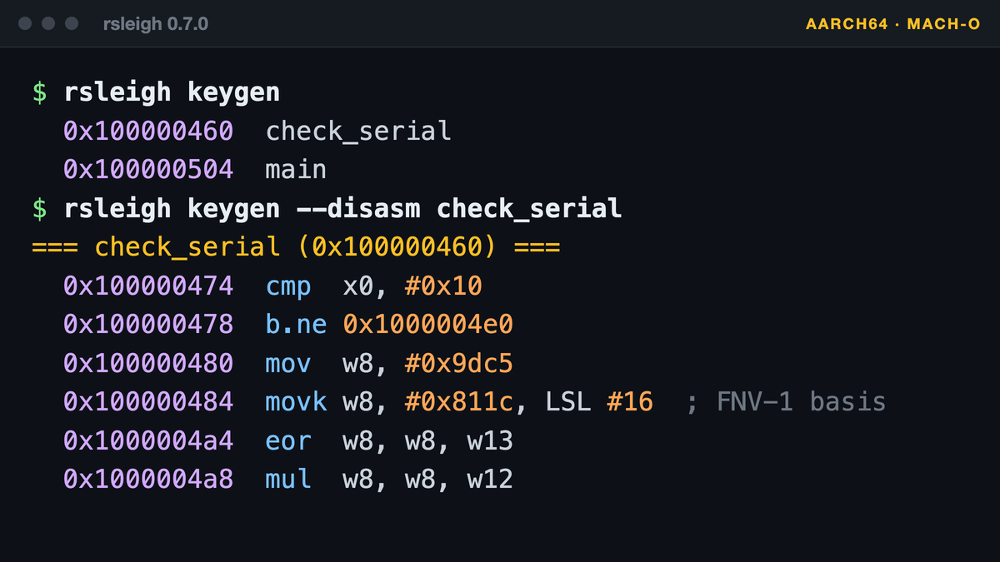
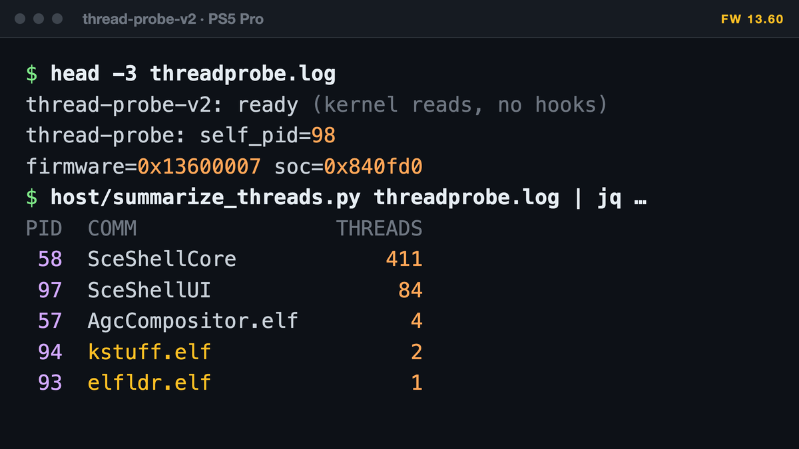
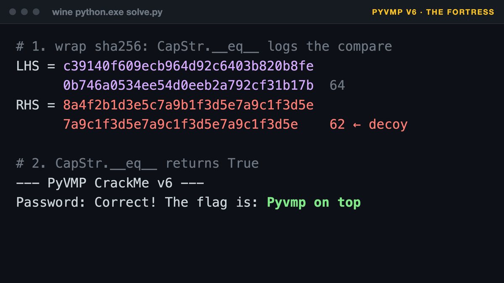
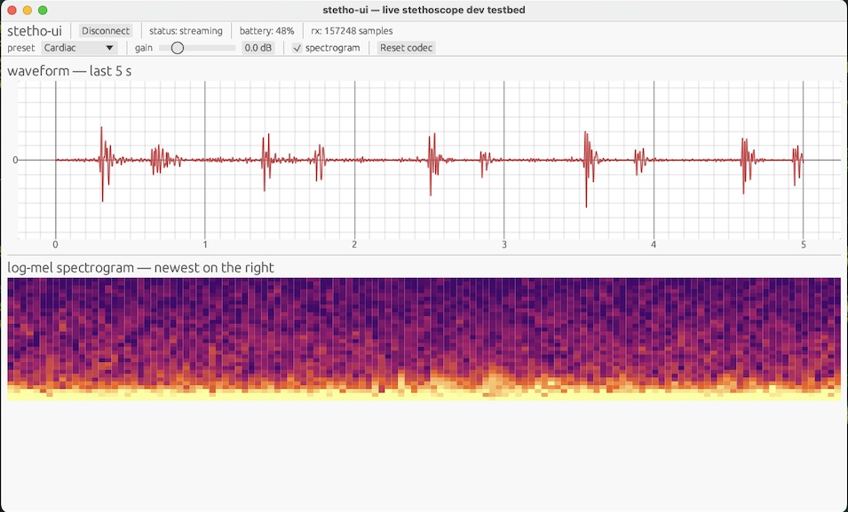
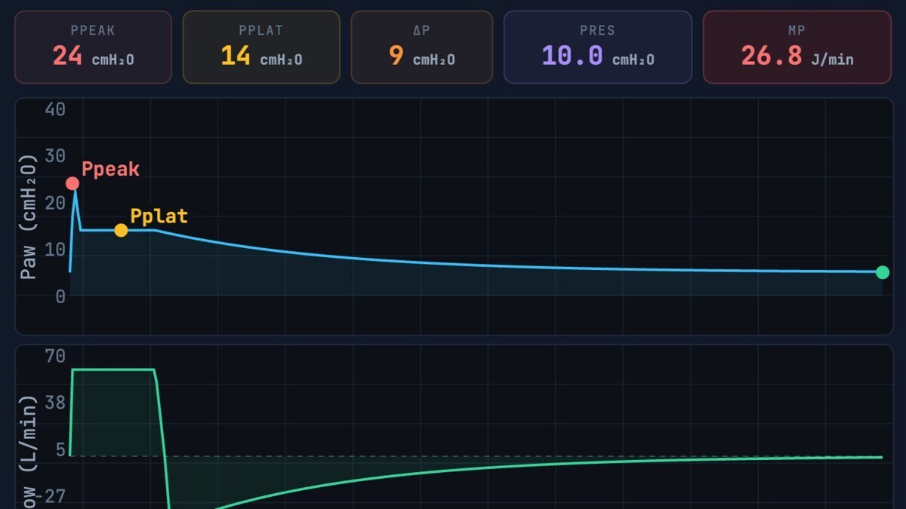
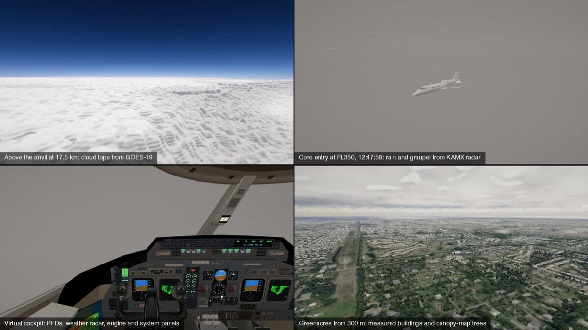
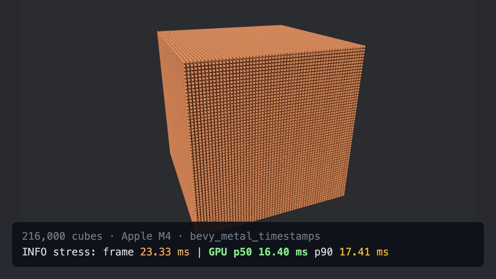
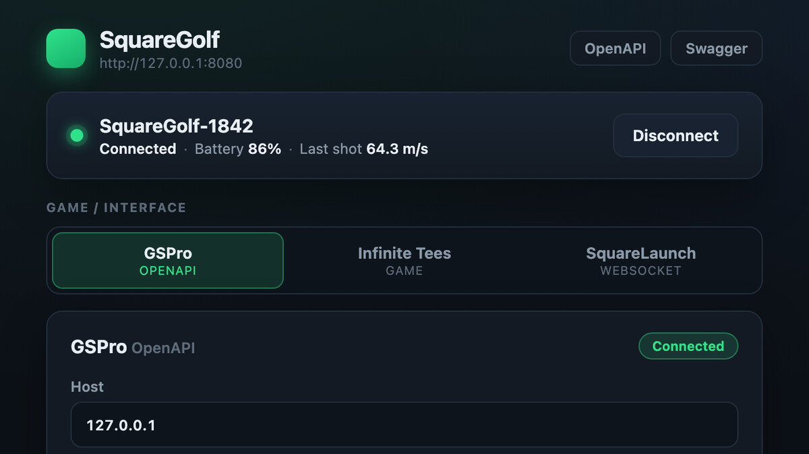

### Hi, I'm Shane

Physician who also builds software, mostly by taking things apart first.

This profile is two halves of that: tools for the clinic (stethoscopes, ECGs, ventilator teaching) and tools for understanding compiled software. The rest is flight and golf simulators, and small fixes for things that broke.

#### Reverse engineering

<table>
  <tr>
    <td width="33%" valign="top">
      
      <b><a href="https://github.com/ShaneBreazeale/rsleigh">rsleigh</a></b> 
      Rust · <a href="https://github.com/ShaneBreazeale/rsleigh/releases/latest">v0.7.0</a> 
      A pure-Rust reverse engineering workbench driven by Ghidra's SLEIGH specs: multi-arch decompilation, P-code, binary triage and LLM-assisted analysis.
    </td>
    <td width="33%" valign="top">
      
      <b><a href="https://github.com/ShaneBreazeale/ps5-homebrew-tools">PS5 homebrew tools</a></b> 
      C 
      Diagnostic payloads and host tools for PS5 homebrew: process and thread capture, kstuff log decoding, kernel-text capture, offline offset analysis and a native app starter.
    </td>
    <td width="33%" valign="top">
      
      <b><a href="https://github.com/ShaneBreazeale/CrackMe_PyVMP_v6">PyVMProtect crackmes</a></b> 
      Python · <a href="https://github.com/ShaneBreazeale/pyvmprotect-static-lift">original</a> · <a href="https://github.com/ShaneBreazeale/crackme-pyvmprotect-v5">v5</a> · <a href="https://github.com/ShaneBreazeale/CrackMe_PyVMP_v6">v6</a> 
      Static lifts of three PyVMProtect-obfuscated crackmes, each a custom stack VM: handlers decoded with Unicorn, hash preimage bounds recovered, a Wine audit-hook crack for "The Fortress".
    </td>
  </tr>
</table>

#### For the clinic

<table>
  <tr>
    <td width="33%" valign="top">
      
      <b><a href="https://github.com/ShaneBreazeale/openstetho">openstetho</a></b> 
      Python · <a href="https://github.com/ShaneBreazeale/openstetho/releases/latest">v0.4.1</a> 
      A toolkit for Bluetooth digital stethoscopes: capture, DSP, log-mel spectrograms and murmur classification on the Apple Neural Engine.
    </td>
    <td width="33%" valign="top">
      
      <b><a href="https://github.com/ShaneBreazeale/kardia-rs">kardia-rs</a></b> 
      Rust 
      A Rust Bluetooth LE workbench for the Kardia 6L six-lead ECG.
    </td>
    <td width="33%" valign="top">
      
      <b><a href="https://github.com/ShaneBreazeale/learn-vents">learn-vents</a></b> 
      Web · <a href="https://pulmcrit.netlify.app">live</a> 
      An interactive tool for teaching mechanical ventilation physiology to residents and fellows. Sibling: <a href="https://github.com/ShaneBreazeale/insulinclac">insulinclac</a>, a <a href="https://penrx.netlify.app/">PWA</a> for writing insulin pen prescriptions.
    </td>
  </tr>
</table>

#### Simulation and graphics

<table>
  <tr>
    <td width="33%" valign="top">
      
      <b><a href="https://github.com/ShaneBreazeale/machtuck">machtuck</a></b> 
      WebGL2 
      A convective upset simulator for the Learjet 60 (N722BD), in the browser.
    </td>
    <td width="33%" valign="top">
      
      <b><a href="https://github.com/ShaneBreazeale/bevy-metal-timestamps">bevy-metal-timestamps</a></b> 
      Rust · Bevy 0.20 
      Real per-frame GPU time for Bevy on Apple GPUs, using Metal pass-boundary timestamp queries.
    </td>
    <td width="33%" valign="top">
      
      <b><a href="https://github.com/ShaneBreazeale/squaregolf-connector">Golf launch monitor connectors</a></b> 
      Rust · <a href="https://github.com/ShaneBreazeale/squaregolf-connector/releases/latest">Square Golf</a> · <a href="https://github.com/ShaneBreazeale/garmingolf-connector/releases/latest">Garmin</a> 
      Multi-platform bridges that send launch monitor shots to golf simulators: a Tauri desktop app for Square Golf (GSPro, Infinite Tees, SquareLaunch) and a Garmin E6 / Play on PC bridge for GSPro. Forked from community projects.
    </td>
  </tr>
</table>

**Fixes:** [macos-postscript-print-fix](https://github.com/ShaneBreazeale/macos-postscript-print-fix) restores PostScript printing to AirPrint printers over Horizon/Citrix and `lp`. [speechmike-horizon-usb-fix](https://github.com/ShaneBreazeale/speechmike-horizon-usb-fix) gets a Philips SpeechMike into Horizon's USB redirection menu. [invisible-unicode-scan](https://github.com/ShaneBreazeale/invisible-unicode-scan) is a GitHub Action that catches the invisible Unicode used in Glassworm-style supply-chain attacks.

**Older golf bridges:** Python interfaces between GSPro and the [GC2 over USB](https://github.com/ShaneBreazeale/GSPro-gc2-API-Interface) and [Flightscope via OCR](https://github.com/ShaneBreazeale/GSPro-Flightscope-OCR-Interface).

**Elsewhere:** [shaneb.org](https://shaneb.org)
